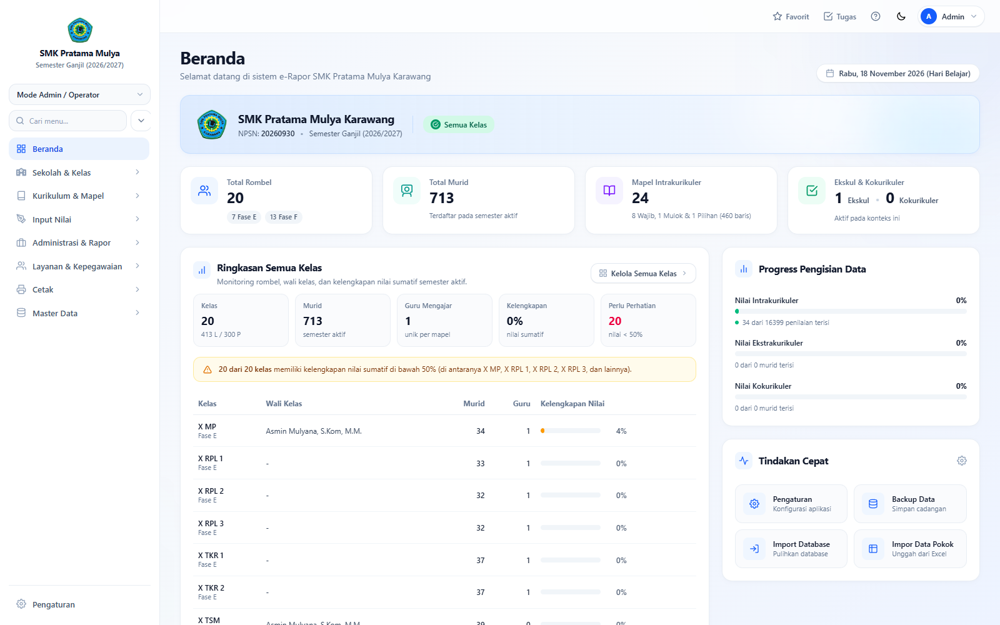
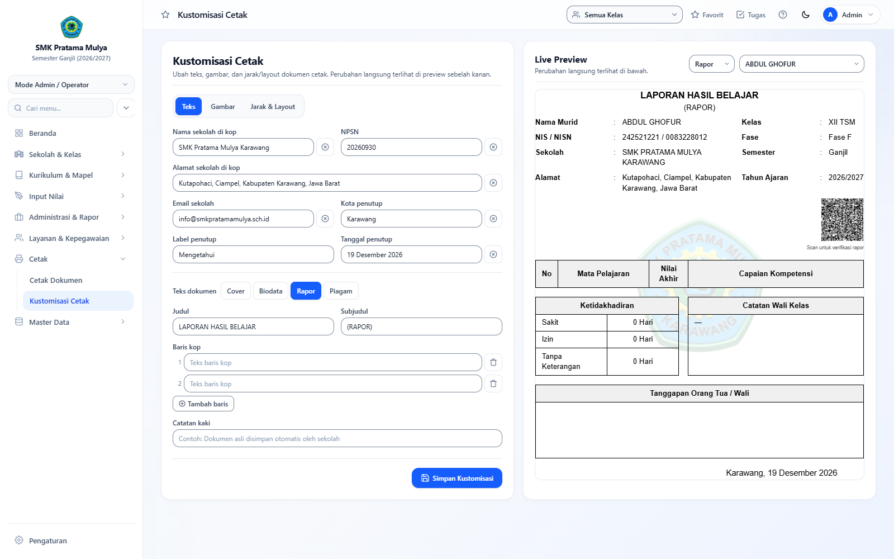
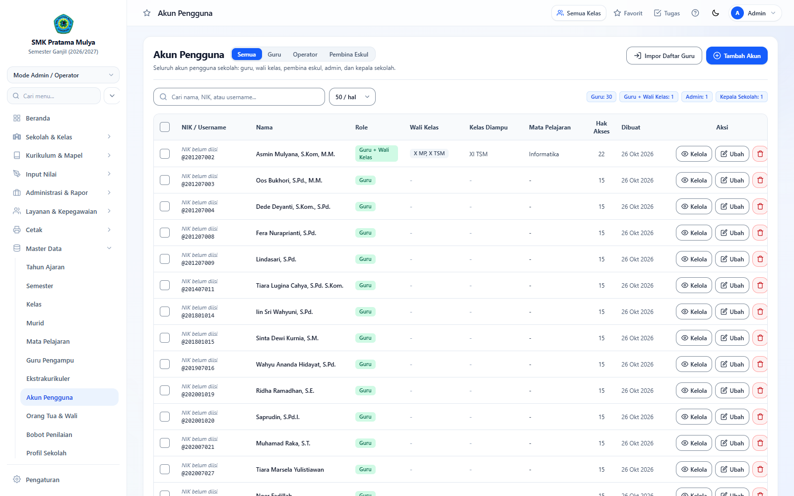
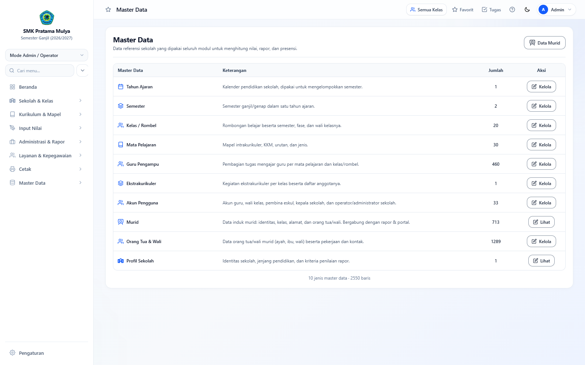
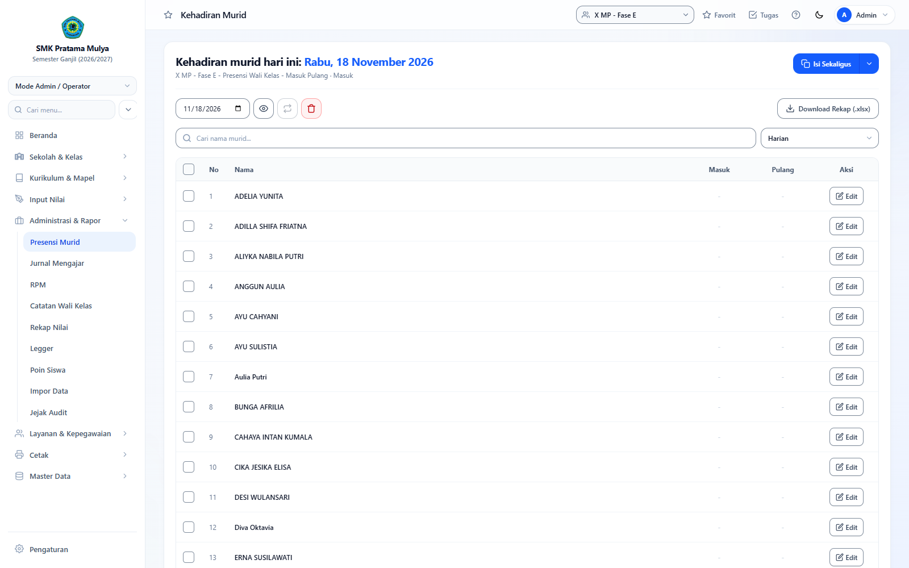

# e-Rapor SMK Pratama Mulya


<a href='https://nodejs.org/en' target="_blank"></a> <a href='https://svelte.dev/' target="_blank"></a> <a href='https://orm.drizzle.team/' target="_blank"></a> <a href='https://sqlite.org/' target="_blank"></a> <a href='https://tailwindcss.com/' target="_blank"></a> <a href='https://daisyui.com/' target="_blank"></a>

e-Rapor SMK Pratama Mulya adalah aplikasi administrasi guru dan penilaian Kurikulum Merdeka untuk SMK Pratama Mulya Karawang. Repositori ini merupakan varian web daring yang berjalan dengan database terpusat (Cloudflare D1 atau LibSQL/SQLite) dan mendukung deployment Node.js maupun Vercel di https://erapor-pmk.titipit.id.

> **Mengapa tetap memakai aplikasi ini bersama E-Rapor resmi?**

E-Rapor resmi berfokus pada pengisian nilai akhir semester dan penentuan ketercapaian Tujuan Pembelajaran (TP). Aplikasi ini mencatat proses harian yang mendahuluinya: penilaian formatif, sumatif lingkup materi, STS, SAS, presensi, jurnal mengajar, hingga rekap nilai otomatis sebelum nilainya dikirim atau diekspor ke E-Rapor Kemdikdas.

Pembahasan teknis dan catatan pengembangan lengkap tersedia di folder `docs/`.

## Daftar fitur

- Pembuatan Lingkup Materi dan Tujuan Pembelajaran (TP) memakai generator AI berdasarkan Capaian Pembelajaran BSKAP.
- Input nilai intrakurikuler (asesmen formatif, sumatif materi, STS, SAS), kokurikuler, P5, PKL/Prakerin, serta ekstrakurikuler lengkap dengan legger dan rekap keseluruhan.
- Pemilih modul kerja di sidebar (`Mode Admin / Operator`, `Modul Wali Kelas`, `Modul Guru`) serta ruang kerja otomatis `Pembina Eskul` untuk pembina eksternal tanpa masuk ke daftar pegawai atau presensi guru.
- Pengelolaan Akun Pengguna terpadu (`/master-data/pengguna`) dengan filter tab `Semua`, `Guru`, `Operator`, dan `Pembina Eskul`, termasuk impor daftar guru dari Excel atau CSV.
- Penjadwalan pelajaran dengan bel sekolah otomatis (`/jadwal-pelajaran`) dan layar monitoring publik `/tamu` untuk buku tamu digital.
- Presensi murid harian dan per mata pelajaran untuk guru mapel maupun wali kelas, jurnal harian guru, poin siswa, dinas luar, serta cetak SPPD otomatis.
- Cetak cover, biodata, rapor, dan piagam dalam format PDF dengan halaman kustomisasi kop, logo, watermark, dan tata letak disertai live preview (`/cetak/kustomisasi`).
- Penulisan Capaian Pembelajaran (CP) dan deskripsi rapor dengan campuran huruf Latin dan Arab.
- Portal Orang Tua (`/portal-orang-tua`), pengelolaan tanda tangan digital, serta tarik data dan kirim nilai akhir/matev ke Dapodik.
- Mode `Semua Kelas` bagi admin dan kepala sekolah untuk memantau seluruh rombel sekaligus dalam mode tampilan terang atau gelap.

## Screenshot

### Dashboard



### Kustomisasi cetak (live preview)



### Akun pengguna terpadu



### Master data



### Presensi murid



## Kecocokan penggunaan

Aplikasi ini cocok untuk sekolah yang ingin mencatat penilaian harian, presensi, jurnal mengajar, dan ekstrakurikuler secara elektronik agar rekap nilai rapor akhir tidak lagi dihitung manual di Excel. Sekolah swasta atau sekolah Islam yang menuliskan Capaian Pembelajaran berbahasa Arab dan Latin dalam satu dokumen rapor juga didukung penuh.

## Quickstart

### Deployment web (Vercel / Cloudflare D1)

Konfigurasi adapter pada `svelte.config.js` memilih `@sveltejs/adapter-vercel` secara otomatis saat `VERCEL=1` atau `ADAPTER=vercel`:

```bash
vercel deploy --prod
```

Atur variabel lingkungan koneksi database terpusat (`DB_URL` dan `DB_AUTH_TOKEN`, atau kredensial D1 sesuai pengaturan proyek) pada panel Vercel.

### Jalankan lokal dengan Node.js

Persyaratan yang perlu disiapkan adalah Node.js 20 LTS atau lebih baru, `pnpm`, serta Google Chrome atau Chromium untuk rendering PDF lewat PagedJS dan Puppeteer.

1. Clone repositori dan masuk ke direktori proyek:

   ```bash
   git clone https://github.com/athuridha/erapor-pmk-online && cd erapor-pmk-online
   ```

2. Pasang dependency proyek:

   ```bash
   pnpm install
   ```

3. Jalankan server pengembangan di port `5173` (atau buat build produksi dengan `pnpm build && node build`):

   ```bash
   pnpm dev -- --port 5173
   ```

Untuk pengguna aplikasi desktop Windows tanpa server terpisah, installer `ERaporPMKSetup.exe` tersedia di halaman rilis https://github.com/athuridha/eraport/releases.

### Skrip penting

Daftar lengkap tersedia di `package.json`:

- `pnpm dev`: menjalankan server pengembangan (`node scripts/dev.js`) sekaligus generator ikon.
- `pnpm build`: membuat build produksi (`adapter-node` bawaan, atau `ADAPTER=vercel` untuk Vercel).
- `pnpm db:push`: menerapkan perubahan skema database lewat skrip migrasi khusus.
- `pnpm db:studio`: membuka Drizzle Studio untuk memeriksa tabel database.
- `pnpm lint` dan `pnpm check`: memeriksa pemformatan Prettier, aturan ESLint, dan tipe Svelte.
- `pnpm screenshot:readme`: memperbarui tangkapan layar aplikasi pada folder `static/` dari server lokal yang sedang berjalan.

Lokasi database SQLite bawaan saat berjalan lokal:

```text
data/database.sqlite3
```

### Skills untuk AI coding agent

Instruksi khusus untuk AI agent berada di folder `.agents/skills/`:

- Strix security testing (9 skill audit keamanan, panduan di `docs/SKILLS.md`).
- Penulisan bahasa Indonesia (`bahasa-inti` dan `bahasa-website`).

## Struktur proyek

- `src/`: kode sumber aplikasi SvelteKit (halaman, API route, komponen UI, dan logika server).
- `static/`: aset statis, logo, suara bel, dan screenshot dokumentasi.
- `scripts/`: skrip utilitas untuk migrasi, seed data, pembaruan screenshot, dan build.
- `data/`: direktori database SQLite lokal serta berkas unggahan saat mode lokal.
- `drizzle/`: berkas migrasi SQL Drizzle ORM.

Detail pola pengembangan memakai Svelte 5 Runes, Tailwind CSS v4, DaisyUI, dan Drizzle ORM dijelaskan di `docs/DEVELOPMENT.md`.

## Lisensi

Perangkat lunak ini dirilis dengan lisensi khusus pada file `LICENSE`. Anda boleh menggunakan, menyalin, dan memodifikasi kode untuk keperluan nonkomersial dengan mempertahankan atribusi pembuat asli, namun dilarang menjual atau memonetisasi aplikasi maupun hasil turunannya.

Ikon pada folder `src/lib/icons` bersumber dari Feather Icons berlisensi MIT (catatan kredit tersedia di `docs/ICON-CREDITS.md`).

## Kontribusi & bantuan

Sebelum mengirim Pull Request, pastikan `pnpm lint` dan `pnpm check` selesai tanpa error serta seluruh teks antarmuka menggunakan bahasa Indonesia yang baku. Jika menemukan bug atau kendala penggunaan, silakan buat Issue di repositori GitHub.
